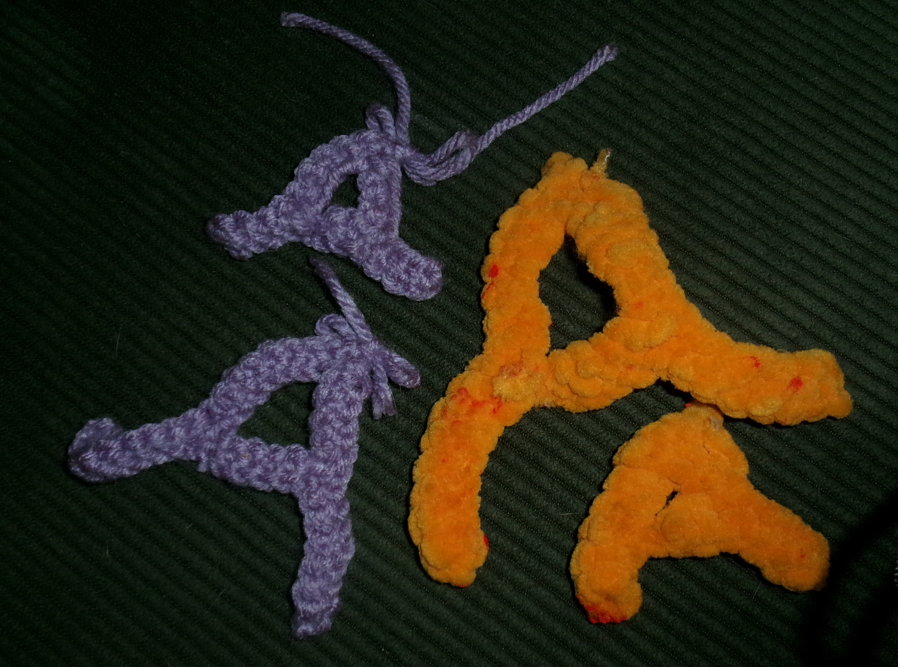
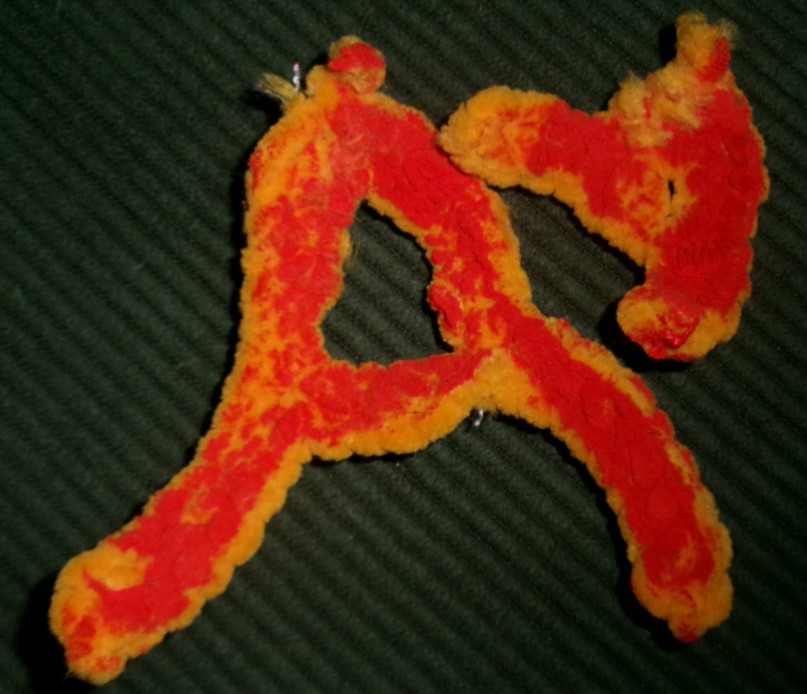

# Process

## 1st Stage
- I started by choosing a crochet hook and yellow and purple yarn.
- I crocheted four capital letter A shapes in different sizes.

## 2nd Stage
- I experimented with dipping the crocheted letters into orange paint to create stamp-like prints.
- The stamping experiment did not work as expected, as the letters did not produce clear prints.
- I decided to keep the crocheted letters in their original form.
- As a final touch, I applied red paint to one side of the letters, creating a two-colour effect.
- The final result combines the texture of crochet with contrasting colours, highlighting the shape of the letter A.

## Protest for independent media
One day, my classmates and I decided to leave halfway through our class to join a protest in Prague in support of Czech Television and Czech Radio’s independence. We felt that the issue was extremely important and that it was worth showing our support in person rather than simply talking about it.
